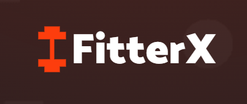

# 🏋️ FitterX — Fitness & Workout Website

<p align="center">
  
</p>

<p align="center">
  <strong>Train with purpose. Move with confidence.</strong><br>
  A responsive, multi-page fitness website featuring workout categories, gym classes, membership plans, and fitness-inspired content.
</p>

<p align="center">
  
  
  
  
  
</p>

<p align="center">
  <a href="#-features">Features</a> ·
  <a href="#-pages--workout-library">Pages</a> ·
  <a href="#-getting-started">Getting Started</a> ·
  <a href="#-project-structure">Project Structure</a>
</p>

---

## ✨ About FitterX

**FitterX** is a fitness and gym website built with **HTML5, CSS3, and vanilla JavaScript**. It brings workout discovery and gym information together in a clean, bold interface designed for desktop, tablet, and mobile screens.

Explore the landing page, browse exercises by muscle group, view fitness classes and membership options, and find dedicated Contact, Join, Privacy Policy, and Terms & Conditions pages.

> **Project type:** Static front-end website — no framework, package installation, or build step is required.

## 🚀 Features

### 🏠 Fitness-focused landing page

- Hero section with prominent calls to action.
- About section and fitness highlights.
- Fitness class cards, including strength training, cardio, and yoga.
- Membership plan cards for Basic, Premium, and Elite tiers.
- Member testimonials and a fitness blog preview.

### 💪 Exercise library

Explore dedicated pages for different training areas:

- Core & upper body: **Abs, Chest, Back, Biceps, Triceps, Forearms, Shoulders**
- Lower body: **Legs, Glutes**
- Conditioning: **Cardio**

### 📱 Responsive experience

- Layouts designed to adapt to desktop, laptop, tablet, and mobile screens.
- Collapsible navigation for smaller screens.
- Scroll-responsive header and a back-to-top control.
- Consistent visual styling and reusable page assets.

### 📄 Essential pages

- Contact Us
- Join FitterX
- Privacy Policy
- Terms & Conditions

## 🧭 Pages & Workout Library

| Page | What you'll find |
|---|---|
| **Home** | Overview of FitterX, classes, membership plans, testimonials, and blog highlights. |
| **Exercises** | Main library for exploring workout categories. |
| **Abs** | Core and abdominal exercises. |
| **Back** | Back training exercises. |
| **Biceps** | Biceps-focused exercises. |
| **Cardio** | Cardio and conditioning exercises. |
| **Chest** | Chest training exercises. |
| **Forearms** | Forearm exercises. |
| **Glutes** | Glute-focused exercises. |
| **Legs** | Leg training exercises. |
| **Shoulders** | Shoulder exercises. |
| **Triceps** | Triceps-focused exercises. |
| **Contact Us** | Contact information and contact page. |
| **Join FitterX** | Join and membership information. |
| **Privacy Policy** | Privacy information. |
| **Terms & Conditions** | Website terms. |

## 🛠️ Built With

| Technology | Purpose |
|---|---|
| **HTML5** | Page structure and content |
| **CSS3** | Layout, styling, and responsive presentation |
| **JavaScript** | Navigation interactions and scroll-based behaviour |
| **Google Fonts** | Catamaran and Rubik typography |
| **Ionicons** | Interface icons |

Google Fonts and Ionicons are loaded from external services, so an internet connection is needed for those resources to appear.

## 🖥️ Getting Started

You can run FitterX locally without installing dependencies.

### 1. Clone the repository

Replace `YOUR_USERNAME` with your GitHub username and use your repository name if it differs from the example below.

```bash
git clone https://github.com/YOUR_USERNAME/fitterx-fitness-website.git
```

### 2. Open the project folder

```bash
cd fitterx-fitness-website
```

### 3. Launch the website

Open `index.html` in your browser.

**Recommended for development:** Open the folder in Visual Studio Code and run `index.html` with the **Live Server** extension. This automatically refreshes the browser when you make changes.

## 📂 Project Structure

```text
fitterx-fitness-website/
├── index.html
├── favicon.svg
├── README.md
├── LICENSE
├── .gitignore
└── assets/
    ├── css/
    │   ├── style.css
    │   ├── global-exercises.css
    │   ├── excercises.css
    │   ├── back.css
    │   ├── chest.css
    │   ├── contact.css
    │   ├── join.css
    │   ├── privacy.css
    │   └── terms.css
    ├── html/
    │   ├── abs.html
    │   ├── back.html
    │   ├── biceps.html
    │   ├── cardio.html
    │   ├── chest.html
    │   ├── contact.html
    │   ├── exercises.html
    │   ├── forearms.html
    │   ├── glutes.html
    │   ├── join.html
    │   ├── legs.html
    │   ├── privacy.html
    │   ├── shoulders.html
    │   ├── terms.html
    │   └── triceps.html
    ├── images/
    │   └── Fitness, hero, class, exercise, and blog image assets
    └── js/
        └── script.js
```

> **Note:** The file `assets/css/excercises.css` uses that spelling in the current project. Keep the filename and its references consistent unless you update both.

## 🎨 Make It Your Own

- **Main page styling:** Edit `assets/css/style.css`.
- **Exercise library styling:** Edit `assets/css/excercises.css` and `assets/css/global-exercises.css`.
- **Individual pages:** Update the relevant file in `assets/html/` and its associated stylesheet in `assets/css/`.
- **Images and visual assets:** Replace or add files in `assets/images/`, keeping image paths in the HTML and CSS up to date.
- **Navigation behaviour:** Update `assets/js/script.js`.
- **Browser tab icon:** Replace or update `favicon.svg`.

## 🗺️ Ideas for Future Improvements

The current project focuses on the front-end experience. Possible next steps include:

- [ ] Add a BMI and calorie-needs calculator.
- [ ] Create interactive workout plans and a workout tracker.
- [ ] Add nutrition guides and personalised fitness goals.
- [ ] Add a light/dark theme switcher.
- [ ] Connect membership and contact forms to a backend service.
- [ ] Add secure user accounts and saved workout routines.
- [ ] Improve accessibility with keyboard navigation and additional checks.

## 🤝 Contributing

Ideas, bug reports, and improvements are welcome.

1. Fork the repository.
2. Create a branch for your change: `git checkout -b feature/your-improvement`.
3. Make and test your changes at different screen sizes.
4. Commit your work and open a pull request with a clear description.

For larger changes, consider opening an issue first so the approach can be discussed.

## 📄 License

FitterX is distributed under the **MIT License**. See the [`LICENSE`](LICENSE) file for details.

## 👨‍💻 Author

**Samyak Dutta**  

---

<p align="center">
  <strong>Keep showing up. Keep getting stronger.</strong><br>
  If you find FitterX useful or inspiring, consider giving the repository a ⭐ on GitHub.
</p>
